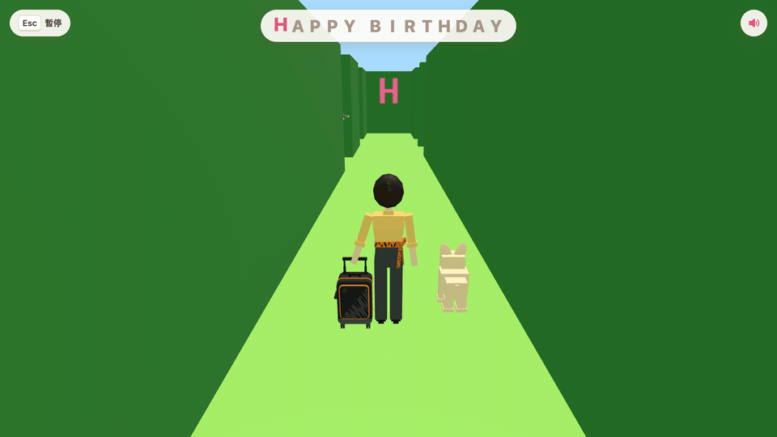

# 生日迷宮

一個祝人生日快樂的 3D 迷宮小遊戲。

**[在瀏覽器裡玩](https://aj006600.github.io/hbd-3d-maze-game/)**(用桌機,需要鍵盤和滑鼠)

<!-- README 對外把奧客稱作老鼠;GLOSSARY、程式碼與遊戲畫面仍稱奧客 -->



## Development

開發機只需要 Docker 與 make,不必裝 Node。

```bash
make local   # http://localhost:3000,存檔後畫面就更新
make test    # 跑測試,與 CI 同一套環境
make help    # 其餘指令
```

| 想做的事 | 看這份 |
|----------|--------|
| 本機開發、測試、專案結構 | [docs/development.md](docs/development.md) |
| 發佈到 GitHub Pages、退回舊版 | [docs/deployment.md](docs/deployment.md) |
| 為什麼這樣設計 | [docs/adr/](docs/adr/) |
| 遊戲裡的用詞 | [GLOSSARY.md](GLOSSARY.md) |

## Credits

音樂放在 `src/audio/music/`,音效放在 `src/audio/sounds/`,只用 CC0 或 CC BY 授權的音檔。

### Music

| 畫面 | 曲名 | 作者 | 授權 |
|------|------|------|------|
| 開始畫面、失敗畫面 | [Pleasant Creek](https://opengameart.org/content/pleasant-creek)(循環版) | Matthew Pablo | CC BY 3.0 |
| 遊戲中、暫停畫面 | [Flowerbed Fields \[Loop\]](https://opengameart.org/content/flowerbed-fields-loop) | Zane Little Music | CC0 |
| 破關畫面 | [Happy Birthday Music Box](https://freesound.org/people/Percy%20Duke/sounds/23270/) | Percy Duke | CC BY 3.0 |

CC BY 3.0 的標註:

- "Pleasant Creek" by Matthew Pablo (http://www.matthewpablo.com), CC BY 3.0, https://opengameart.org/content/pleasant-creek
- "Happy Birthday Music Box.MP3" by Percy Duke (https://freesound.org/s/23270/), CC BY 3.0

<details>
<summary>檔案與原檔的關係</summary>

曲子本身都沒有改動:

- Pleasant Creek:循環版的原檔是 WAV,轉成 OGG 才能無縫循環。
- Flowerbed Fields [Loop]:原檔的 OGG。
- Happy Birthday Music Box:Freesound 頁面上不必登入就能下載的 HQ 預覽檔,是 Freesound 由原檔(128 kbps 的 MP3)轉出的 MP3。

</details>

### Sound Effects

| 時機 | 檔案 | 音效包 | 授權 |
|------|------|--------|------|
| 收集成功 | `confirmation_001.ogg` | [Interface Sounds](https://kenney.nl/assets/interface-sounds) | CC0 |
| 按錯字母 | `question_004.ogg` | [Interface Sounds](https://kenney.nl/assets/interface-sounds) | CC0 |
| 門打開 | `jingles_PIZZI10.ogg` | [Music Jingles](https://kenney.nl/assets/music-jingles) | CC0 |
| 倒數最後 30 秒的每一秒 | `glass_001.ogg` | [Interface Sounds](https://opengameart.org/content/interface-sounds) | CC0 |
| 揮空時登機箱揮下去 | `impactPlate_heavy_001.ogg` | [Impact Sounds](https://kenney.nl/assets/impact-sounds) | CC0 |
| 打中老鼠(第 1、2 下) | `impactSoft_heavy_001.ogg` | [Impact Sounds](https://kenney.nl/assets/impact-sounds) | CC0 |
| 擊倒老鼠(第 3 下) | `impactPunch_heavy_000.ogg` | [Impact Sounds](https://kenney.nl/assets/impact-sounds) | CC0 |
| 老鼠發現主角 | `error_006.ogg` | [Interface Sounds](https://opengameart.org/content/interface-sounds) | CC0 |
