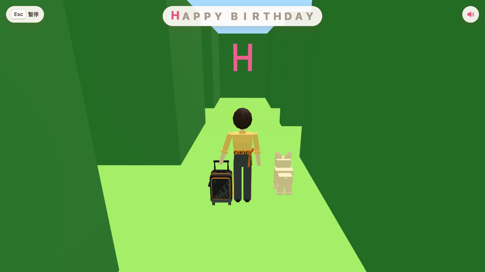

# 3d-maze-game

生日迷宮:一個在瀏覽器裡玩的 3D 迷宮遊戲,主角帶著狗在迷宮裡依序收集拼出 HAPPY BIRTHDAY 的字母,打開門走出去。



## How to Play

**目標**:迷宮的死路裡放著 A 到 Z 的字母。照 HAPPY BIRTHDAY 的順序收集字母(空格不算,共 13 個),
集滿最後一個時門就打開,從門走出去就破關。站在不是下一個要收的字母那裡按 F,這一下不算數,進度也不會倒退。

**奧客**:迷宮裡有兩位奧客,在走道上走走停停地遊蕩。主角走到奧客 3 格以內、中間又沒有牆擋住時,奧客就發現主角,
這時會響一聲提示,奧客臉旁也冒出一個對話框,唸著乘客的抱怨;之後在追趕的期間每隔幾秒換一句,遊蕩的奧客不講話。
發現主角的奧客跑得比主角快一點,沿著走道追過來,主角跑出視線或跑遠都甩不掉他。
奧客不會傷害主角,只會貼在主角身邊擋路:他們身材高大、幾乎塞滿走道,主角推不動、貼著走道的一側或在轉角也繞不過他們,
走進死路時,跟進來的奧客會把死路的開口擋住。奧客擋在鏡頭前面時會變成半透明。
要擺脫奧客只能擊倒他:面向奧客揮擊登機箱,他被打中時會閃一下白、停下來一小段時間,打中 3 次就倒在地上,
從倒地的那一刻起不再擋路,停一下就消失。打中的次數不會隨時間歸零。被擊倒的奧客 5 秒後在迷宮裡另一個主角看不到的地方重生,
回到遊蕩。兩位奧客都在面前時,一次揮擊可以同時打中兩位。

**操作**:打開網頁先點一下禮物盒,音樂從這一下開始播;在開始畫面選時限(5 分鐘、10 分鐘、20 分鐘或不限時,預設不限時),
再按「開始」鎖定游標,進入迷宮。有時限的一局在通關字串下方倒數,剩 30 秒起數字變紅閃動、每過一秒響一聲提示聲,
倒數歸零時還沒走出門就是挑戰失敗。
破關畫面可以「再玩一次」,失敗畫面可以「再試一次」,兩者都沿用同一個時限;也都可以回到開始畫面重新選時限。

| 按鍵 | 動作 |
|------|------|
| `W` `A` `S` `D` | W 前進、S 倒退、A 與 D 橫移 |
| 滑鼠 | 左右移動轉向,上下移動調整俯仰角 |
| `F` | 站進有字母的死路時收集字母 |
| 滑鼠左鍵 / 空白鍵 | 揮擊登機箱:雙手把它由右上往左下揮一次,揮的時候照樣可以跑;打中奧客 3 次就擊倒他 |
| `Esc` | 暫停;在暫停畫面按「繼續」接著玩,或回到開始畫面 |
| `M` | 切換靜音,畫面右上角的喇叭圖示顯示目前的狀態 |

## Quick Start

開發機只需要 Docker 與 make,不必裝 Node。

```bash
make local   # http://localhost:3000,改了原始碼存檔畫面就更新(前景執行,Ctrl+C 停止)
make test    # 跑測試(Vitest,與 CI 同一套環境)
make help    # 其餘指令
```

## Docs

| 想做的事 | 看這份 |
|----------|--------|
| **本機開發**(hot reload、測試、lint、清理、worktree) | [docs/development.md](docs/development.md) |
| **發佈**(GitHub Pages、發版、退回舊版、第一次啟用) | [docs/deployment.md](docs/deployment.md) |
| **設計決策**(為什麼這樣選) | [docs/adr/](docs/adr/) |
| **用詞**(迷宮、字母、收集、主角……) | [GLOSSARY.md](GLOSSARY.md) |

## Structure

```
.
├── src/
│   ├── App.jsx             # 首頁就是遊戲:把介面層疊在畫布上,並決定目前停在哪個畫面
│   ├── audio/              # 音訊:依畫面播放音樂、轉場淡出、遊戲中的音效與靜音(Web Audio API),音樂放在 music/、音效放在 sounds/
│   ├── config.js           # 試玩後要調整的設定:seed、通關字串、祝福文字、時限的選項、奧客(人數、碰撞半徑、遊蕩的速度與停頓、發現的距離、追趕的速度、硬直的秒數、擊倒的次數、倒地與重生的秒數、重生的最小距離)、奧客的台詞與對話框輪播的秒數、場景比例(牆高、走道寬度)、收集回饋的長度、揮擊的長度與打中的時間點和範圍、鏡頭距離與俯仰角
│   ├── game/               # 遊戲核心:不依賴 Three.js、React 與瀏覽器 API 的純模組
│   ├── render/             # 渲染層:用 Three.js 把遊戲核心的狀態(包括奧客)畫成 3D 場景,另外負責鏡頭、鍵鼠輸入與跟著主角跑的狗,不持有規則
│   └── ui/                 # 介面層:疊在畫布上的入口畫面、開始畫面、遊戲中的提示、暫停畫面、失敗畫面、破關畫面與喇叭圖示(React),不持有規則
├── tests/                  # Vitest,鏡射 src/ 的結構
├── index.html · vite.config.js · package.json · package-lock.json
├── eslint.config.js        # ESLint:recommended 加 react-hooks
├── prettier.config.js      # Prettier:不加分號、單引號、行寬 120
├── Dockerfile              # 多階段:dev 跑 Vite dev server 與測試工具、build 出靜態檔、site 只放要發佈的靜態檔
├── compose.yaml            # make local:掛載原始碼、開 localhost 埠
├── Makefile                # local·compose / test·lint·format / clean / ps / worktree
├── GLOSSARY.md             # 遊戲的用詞
├── CLAUDE.md · .claude/    # coding agent 的規則與 guard hooks
├── .github/workflows/ci-cd.yml  # test、build 檢查 → Release tag(vX.Y.Z)才發佈到 GitHub Pages
└── docs/                   # development.md · deployment.md · adr/ · agents/(agent skills 的 issue tracker / label / domain 設定)· screenshot.png(上面的遊戲截圖)
```

## Credits

音樂放在 `src/audio/music/`,音效放在 `src/audio/sounds/`,只用 CC0 或 CC BY 授權的音檔。

### Music

| 畫面 | 曲名 | 作者 | 來源 | 授權 |
|------|------|------|------|------|
| 開始畫面、失敗畫面 | Pleasant Creek(循環版) | Matthew Pablo | https://opengameart.org/content/pleasant-creek | CC BY 3.0 |
| 遊戲中、暫停畫面 | Flowerbed Fields [Loop] | Zane Little Music | https://opengameart.org/content/flowerbed-fields-loop | CC0 |
| 破關畫面 | Happy Birthday Music Box | Percy Duke | https://freesound.org/people/Percy%20Duke/sounds/23270/ | CC BY 3.0 |

CC BY 3.0 的標註:

- "Pleasant Creek" by Matthew Pablo (http://www.matthewpablo.com), CC BY 3.0, https://opengameart.org/content/pleasant-creek
- "Happy Birthday Music Box.MP3" by Percy Duke (https://freesound.org/s/23270/), CC BY 3.0

檔案與原檔的關係(曲子本身都沒有改動):

- Pleasant Creek:循環版的原檔是 WAV,轉成 OGG 才能無縫循環。
- Flowerbed Fields [Loop]:原檔的 OGG。
- Happy Birthday Music Box:Freesound 頁面上不必登入就能下載的 HQ 預覽檔,是 Freesound 由原檔(128 kbps 的 MP3)轉出的 MP3。

### Sound Effects

八個音效都是 Kenney(www.kenney.nl)音效包裡的原檔,檔名與內容都沒有改動。

| 時機 | 檔案 | 音效包 | 來源 | 授權 |
|------|------|--------|------|------|
| 收集成功 | `confirmation_001.ogg` | Interface Sounds | https://kenney.nl/assets/interface-sounds | CC0 |
| 按錯字母 | `question_004.ogg` | Interface Sounds | https://kenney.nl/assets/interface-sounds | CC0 |
| 門打開 | `jingles_PIZZI10.ogg` | Music Jingles(Pizzicato jingles) | https://kenney.nl/assets/music-jingles | CC0 |
| 倒數的最後 30 秒,每過一秒 | `glass_001.ogg` | Interface Sounds | https://opengameart.org/content/interface-sounds | CC0 |
| 揮空時登機箱揮下去 | `impactPlate_heavy_001.ogg` | Impact Sounds | https://kenney.nl/assets/impact-sounds | CC0 |
| 打中奧客(第 1、2 下) | `impactSoft_heavy_001.ogg` | Impact Sounds | https://kenney.nl/assets/impact-sounds | CC0 |
| 擊倒奧客(第 3 下) | `impactPunch_heavy_000.ogg` | Impact Sounds | https://kenney.nl/assets/impact-sounds | CC0 |
| 奧客發現主角 | `error_006.ogg` | Interface Sounds | https://opengameart.org/content/interface-sounds | CC0 |
